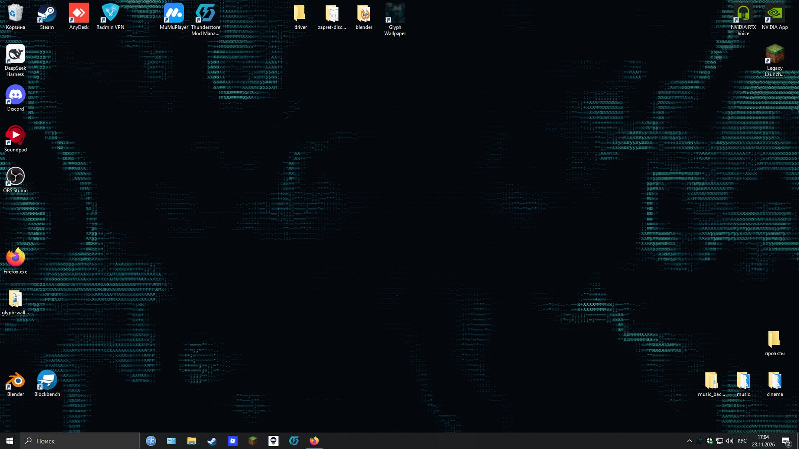
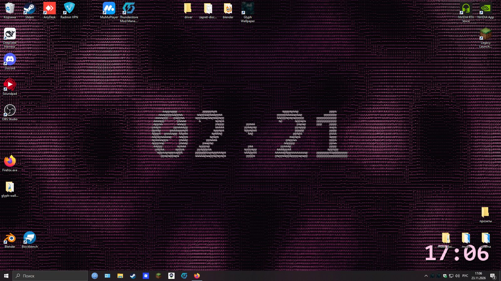
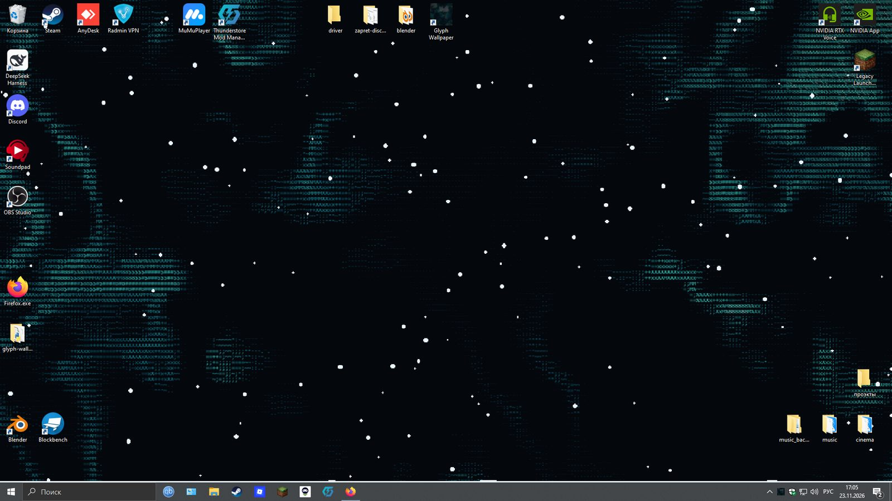
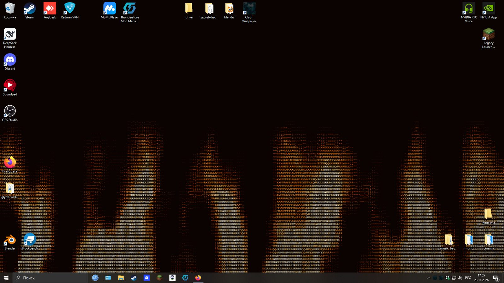

# glyph-wallpaper

**Procedural live wallpaper made of characters for Windows.** Every pixel of the
desktop is a monospace glyph; the pattern is generated from noise fields and
redrawn 20–30 times per second. Runs behind desktop icons (Windows 10 WorkerW
trick), lives in the tray, supports multiple monitors, snow, fire, a countdown
timer drawn in glyphs, and cursor-reactive effects.

Windows 10 · Python 3.10+ · numpy + Pillow · MIT



## Что это

Обои, целиком нарисованные символами. Каждая ячейка экрана — глиф, поле тона
считается процедурно (fbm-шум, векторные поля, интерференция, «матричный дождь»,
пламя), палитра и оттенок применяются к нему же. Поверх — снег, таймер и эффекты
от курсора. Никаких картинок: всё считается из seed'а в реальном времени.

## Возможности

- **8 дизайнов**: жилы, гравюры, матрица, интерференция, бумага, огонь.
- **Живой рендер** 20–30 fps, узор меняется каждый кадр, а не «ездит».
- **Обои за иконками** — ярлыки, меню и клики работают как обычно.
- **Мультимонитор**: один холст, сквозной узор; на мониторе с полноэкранным
  приложением блит ставится на паузу.
- **Трей и автозапуск**: крестик сворачивает в трей, `--live --tray` в автозапуске.
- **Палитра и сдвиг оттенка** на лету.
- **Снег**: падает и копится сугробом над панелью задач.
- **Таймер**: обратный отсчёт, цифры набраны теми же глифами, по центру
  основного монитора; пока идёт — обои не засыпают.
- **Курсор**: аура, магнит, свечение; волна по правому клику; цифры таймера
  колышутся как вода; каждую секунду — маленькая волна от изменившейся цифры,
  каждую минуту — вполовину больше.

| Таймер | Снег | Огонь |
|---|---|---|
|  |  |  |

## Установка готовой сборки

1. Скачайте `GlyphWallpaper-win64.zip` из **Releases** и распакуйте в любую папку.
2. Запустите **`Установить Glyph Wallpaper.bat`** — программа скопируется в
   `%LOCALAPPDATA%\GlyphWallpaper`, появятся ярлыки на рабочем столе и в «Пуск».
3. Откройте ярлык, выберите дизайн, seed, скорость → **▶ Включить обои**.

При выходе (трей → «Выход» или «Остановить обои») анимация плавно гаснет и
**возвращаются ваши обои** — программа хранит путь к текущей картинке рабочего
стола и применяет её обратно.

> Важно: кнопка **Code → Download ZIP** на GitHub даёт только исходники, без
> готового `exe`. Чтобы просто запустить — берите архив из **Releases**.

## Запуск из исходников

```powershell
pip install -r requirements.txt
python app.py            # окно настроек
python app.py --live     # сразу включить обои
python app.py --live --tray   # запуск в трее (для автозапуска)
```

Нужны шрифты Windows `consola.ttf` (латиница, рамки) и `msgothic.ttc`
(катакана для «матрицы») — они есть в системе по умолчанию.

## Сборка exe

```powershell
pip install -r requirements-dev.txt
powershell -File scripts/build.ps1
```

Результат: `dist/GlyphWallpaper/GlyphWallpaper.exe` (папка, без установки Python).
Скрипт также собирает архив для релиза.

## Как устроено

```
app.py          интерфейс (tkinter), настройки, сценарии
engine.py       Win32: окна в WorkerW, DIB + GDI, цикл кадров, паузы
anim.py         покадровый рендер: поля, глифы, палитра, снег, таймер, курсор
glyph_render.py статический рендер (превью, PNG, «статические обои»)
tray.py         иконка в трее (Shell_NotifyIcon)
install.ps1     установщик/деинсталлятор
scripts/build.ps1  сборка PyInstaller
```

Кадр: поле тона на сетке → выбор глифов по плотности краски → цвет из палитры →
композит в PIL → растяжение через GDI на монитор. Рендер идёт в ~1.15 Мпикс и
растягивается — так держится 20–30 fps даже на слабом CPU.

## Ограничения

- Только Windows: используется трюк с `WorkerW`, чтобы рисовать за иконками.
  На нестандартных сборках оболочки он может не сработать — тогда окно ляжет
  поверх стола.
- Шрифты берутся системные, своего шрифта в репозитории нет.
- Тестов нет, это эксперимент; поведение проверялось вручную на Windows 10 22H2.
- Нагрузка: ~15–17 % одного ядра в работе, ~3 % в простое (снижается, когда
  курсор не касается обоев или включён таймер).

## Лицензия

MIT — см. [LICENSE](LICENSE).
